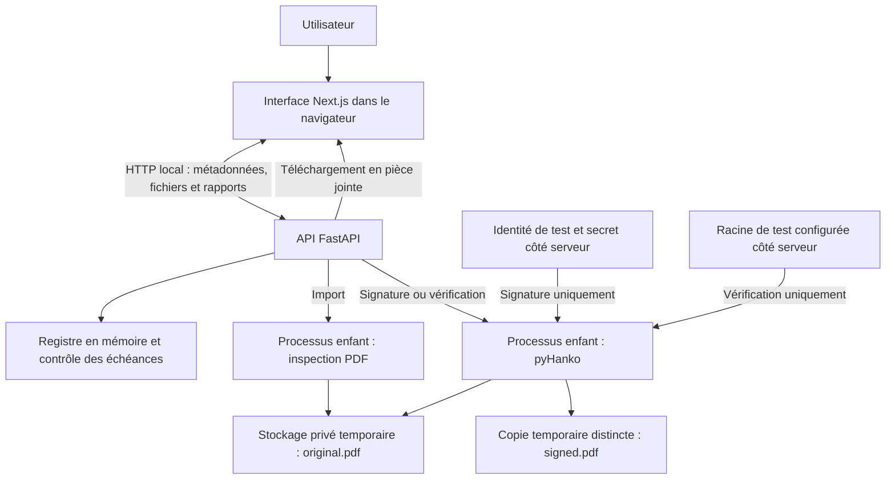

# Architecture locale

DZ Sign fonctionne sur un poste individuel. Le navigateur communique avec l’API locale ; les traitements PDF s’exécutent dans des processus enfants, hors du processus principal FastAPI.

L’interface écoute par défaut sur `127.0.0.1:3000`, l’API sur `127.0.0.1:8000`. Les fichiers sont placés dans `.local/dz-sign/uploads/`, les références et métadonnées restent en mémoire. Il n’y a pas de base de données ni de reprise de session après redémarrage.

Une seule opération PDF est active à la fois. Chaque traitement est borné à trente secondes, avec des limites de mémoire et de CPU. Ces protections ne constituent pas un bac à sable système complet. La clé privée et le secret ne sont jamais transmis au navigateur.

Références : [contrat technique](../docs/fr/reference.md), [code de l’API](../demo/backend/app/main.py), [stockage et orchestration](../demo/backend/app/documents.py).
