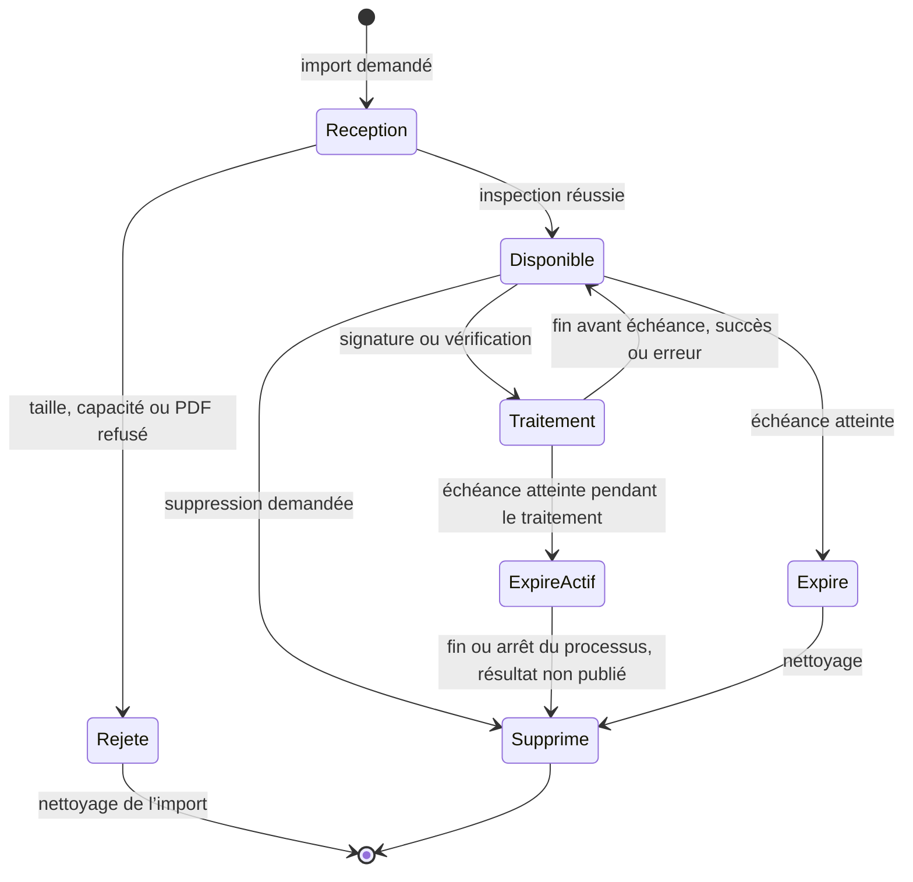

# Cycle de vie des documents

Chaque import accepté conserve son échéance initiale. Signer, vérifier ou télécharger ne renouvelle pas la durée de conservation.

| Règle | Comportement |
|---|---|
| Conservation | Au maximum quinze minutes depuis le début de l’import |
| Capacité | Dix documents ; dix Mio au maximum par original et par copie signée |
| Copie signée | Une copie par import, avec la même échéance que l’original |
| Après échéance | L’API refuse l’accès, même si le nettoyage physique reste à exécuter |
| Traitement actif | Fichiers conservés jusqu’à l’arrêt du processus ; aucun résultat expiré publié |
| Suppression explicite | Original et copie supprimés, références invalidées ; demande refusée si une opération PDF est active |
| Nettoyage | Toutes les minutes, au démarrage et à l’arrêt normal de l’API |
| Redémarrage | Anciennes données temporaires nettoyées ; registre recréé vide |

Le diagramme montre les traitements PDF ; un transfert en cours peut aussi retarder le retrait physique de ses fichiers. La suppression ne garantit pas un effacement forensique du support. Les téléchargements déjà enregistrés par l’utilisateur ne sont pas supprimés de son ordinateur.

Références : [stockage temporaire](../demo/backend/app/documents.py), [confidentialité](../demo/frontend/app/confidentialite/page.tsx).
