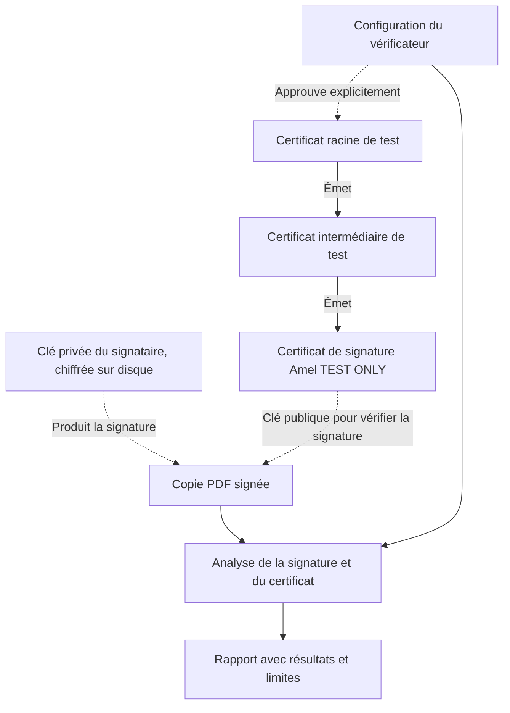

# Chaîne de confiance de test

Les flèches pleines indiquent l’émission des certificats. Les relations en pointillés représentent l’usage des clés ou le choix de confiance du vérificateur.

Les certificats contiennent des clés publiques. La clé privée de signature et son secret restent côté serveur, hors du dépôt Git. Les clés des autorités servent à la génération des certificats ; elles ne sont pas nécessaires à la signature quotidienne des PDF.

Une racine jointe à un PDF ne devient jamais automatiquement une ancre approuvée. Un autre lecteur PDF peut donc indiquer que cette identité de test n’est pas approuvée, même lorsque l’intégrité cryptographique est correcte.

Cette chaîne est pédagogique. Elle ne démontre ni identité civile vérifiée, ni qualification juridique, ni statut de révocation. Aucun service OCSP, CRL ou d’horodatage de confiance n’est mis en œuvre dans ce parcours.

Références : [générateur de certificats](../examples/certificate-generation/README.md), [gestion des clés](../docs/architecture/key-management.md), [fondements](../docs/fr/foundations.md).
