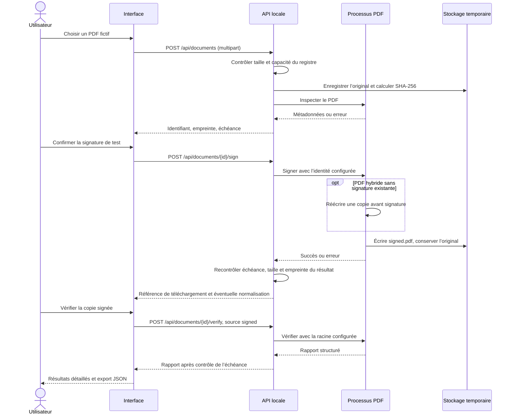

# Import, signature et vérification

La signature produit une copie. La vérification est une action séparée : la disponibilité d’un téléchargement ne constitue pas un verdict sur sa signature.

Tout échec d’import empêche l’enregistrement du document dans le registre. Un échec de signature entraîne la suppression de la sortie partielle. Un original contenant déjà une signature est refusé pour la signature de test ; il peut être vérifié directement.

Le rapport distingue intégrité, certificat et couverture du document. La révocation et l’horodatage de confiance restent non vérifiés. HTTP 200 indique qu’un rapport a été produit, pas que tous les contrôles sont favorables. L’original peut aussi être vérifié en choisissant `source: original`.

Références : [orchestration réelle](../demo/backend/app/documents.py), [signature PDF](../examples/pdf-signing/sign_pdf.py), [vérification PDF](../examples/pdf-signing/verify_pdf.py).
