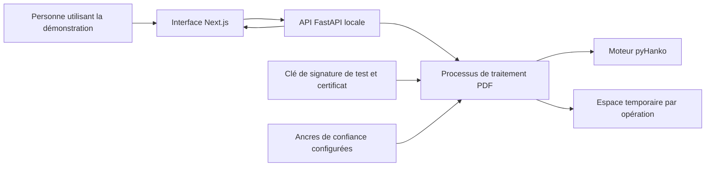

# Architecture de la première démonstration DZ Sign

Que se passe-t-il entre l’import d’un PDF et son téléchargement signé ? Cette fiche définit les composants, les échanges et la durée de conservation des données pour le premier parcours local.

Décisions initiales au **11 novembre 2026**, mises à jour le **13 novembre 2026**. L’[application](../../demo/README.md) implémente le registre documentaire, l’import PDF, la signature de test, les rapports de vérification et le stockage temporaire. Les traitements PDF s’exécutent dans des processus enfants bornés. Cette architecture complète le [cadrage](../introduction/project-scope.md).

## Un parcours local et court

Une personne lance DZ Sign sur sa machine, choisit un PDF fictif puis demande sa signature avec l’identité de test disponible. Elle télécharge le résultat et peut le soumettre à une vérification séparée.

La première version fonctionnera sans comptes utilisateurs, base de données ni historique persistant. Elle sera destinée à une seule personne sur sa machine. Une exposition publique ou un usage partagé demanderait un autre périmètre.

Le choix de pyHanko exprime la direction du projet. La version, les API utilisées et les paramètres seront vérifiés et figés lors des exemples pratiques. Les schémas de cette fiche ne prétendent pas décrire ses fonctions internes.

## Responsabilités

| Composant | Responsabilité |
|---|---|
| Interface | Choix du fichier, confirmation de la signature de test, téléchargement et explication des résultats |
| API | Limites d’import, identifiants opaques, orchestration et réponses d’erreur |
| Processus PDF | Lecture, signature ou vérification avec limite de temps ; nettoyage de ses ressources |
| Moteur cryptographique | Opérations de signature et contrôles retenus après validation des capacités de la bibliothèque |
| Espace temporaire | Fichiers d’entrée et de sortie isolés par opération |
| Configuration de confiance | Ancres explicitement approuvées pour les essais, séparées des certificats reçus |

L’API ne devra pas exécuter directement un traitement PDF lourd dans son processus principal. Pour cette première version, un processus enfant par opération et une seule opération active suffiront ; une file de tâches distribuée n’est pas nécessaire.

## Contrat d’API proposé

Les routes ci-dessous sont implémentées. Le contrat OpenAPI est disponible dans l’application locale.

| Route | Entrée | Résultat |
|---|---|---|
| `GET /api/documents` | Aucune | Documents encore disponibles dans l’instance locale |
| `POST /api/documents` | Un PDF multipart | Identifiant opaque, taille et empreinte calculées côté serveur, échéance de suppression |
| `GET /api/documents/{id}` | Identifiant de document | Métadonnées disponibles jusqu’à l’échéance |
| `GET /api/documents/{id}/download` | Identifiant de document | Original reçu, servi en pièce jointe |
| `POST /api/documents/{id}/sign` | Référence au document importé | Référence à un résultat distinct et échéance de téléchargement |
| `GET /api/results/{id}/download` | Identifiant de résultat | PDF signé, servi comme pièce jointe |
| `POST /api/documents/{id}/verify` | Référence au document importé | Rapport structuré, un résultat par signature détectée |
| `DELETE /api/documents/{id}` | Identifiant de document | Suppression de l’entrée et des résultats associés |

L’identité de signature sera fixée par la configuration serveur. La requête ne pourra sélectionner ni chemin de clé ni ancre de confiance. Les identifiants seront aléatoires, opaques et impossibles à convertir directement en chemins de fichiers ; ils ne remplaceront pas une authentification pour un futur service partagé.

Une entrée rejetée produira une erreur compréhensible : type non accepté, taille dépassée, document introuvable, traitement occupé ou délai dépassé. Une erreur de lecture sera distinguée d’un rapport ayant conclu à une signature incorrecte. Le schéma OpenAPI documentera ces réponses lors de l’implémentation.

## Flux de signature

1. L’API reçoit le fichier en contrôlant la taille pendant la lecture, avant tout traitement PDF.
2. Elle crée un espace isolé et enregistre les octets sous un nom interne généré.
3. Elle calcule l’empreinte du fichier reçu et renvoie ses métadonnées.
4. Après confirmation dans l’interface, le processus PDF charge l’identité de test configurée et produit un nouveau fichier, avec PAdES-B-B comme objectif.
5. Une vérification du résultat est effectuée avant sa mise à disposition. Une erreur empêche sa publication comme résultat réussi.
6. L’interface présente le téléchargement, l’empreinte du résultat et les limites de la démonstration.

La confirmation de l’utilisateur décrit une action de démonstration ; elle ne constitue pas une procédure de consentement à une signature qualifiée. Le fichier importé reste distinct du fichier produit.

## Flux de vérification

Le processus examine les signatures présentes et produit le rapport décrit dans la [fiche de vérification](../cryptography/signature-validation.md) : intégrité, couverture, chaîne, dates, révocation et horodatage. La date d’évaluation courante, exprimée en UTC, et l’identifiant de la configuration de confiance accompagneront les résultats.

Les certificats intégrés au document pourront aider à construire une chaîne, mais ne seront jamais ajoutés automatiquement aux ancres approuvées. Aucun accès automatique aux URL contenues dans le PDF ou les certificats ne sera autorisé. Les contrôles exigeant une ressource absente seront indiqués comme non vérifiés ou indéterminés, avec leur raison.

Un PDF sans signature doit recevoir un résultat explicite. Pour plusieurs signatures ou des révisions complexes, les limites du moteur devront être exposées ; un traitement partiel ne sera pas présenté comme une validation globale.

## Limites et conservation retenues

Valeurs initiales du projet, à confirmer par les essais de consommation mémoire et de durée :

| Paramètre | Valeur de départ |
|---|---|
| Taille maximale d’entrée | 10 Mio par fichier, contrôlée aussi côté serveur |
| Traitements simultanés | Un import ; les demandes supplémentaires reçoivent un état occupé |
| Nombre de documents conservés | Dix maximum, soit au plus 100 Mio de fichiers d’entrée |
| Mémoire du processus d’inspection | Espace virtuel limité à 512 Mio sur POSIX |
| Durée maximale de traitement | 30 secondes par opération, puis arrêt du processus et nettoyage |
| Conservation d’une entrée et de ses résultats | Au maximum 15 minutes après l’import, sans prolongation implicite |
| Nettoyage périodique | Toutes les minutes, avec rattrapage au démarrage |
| Journaux | Type d’opération, durée, code de résultat et identifiant technique ; aucun contenu PDF ni secret |

Les ressources expirées seront immédiatement refusées par l’API, même avant leur suppression physique. Les ressources actives seront supprimées à la fin d’un transfert en cours ; aucun nouveau traitement ne pourra démarrer après l’échéance. Les résultats partiels d’un échec seront supprimés immédiatement.

Les originaux sont stockés dans `.local/dz-sign/uploads/` à permissions restreintes. Au démarrage, le programme nettoie ses anciens dossiers générés avant d’accepter des requêtes. Un verrou exclusif empêche deux instances d’utiliser ce stockage simultanément. Il n’y a pas de reprise de session après redémarrage. La suppression ne promet pas un effacement forensique du support. La réception multipart est bornée avant analyse ; le processus d’inspection a un délai et des limites de mémoire et de CPU. Il ne constitue pas un bac à sable système complet.

## Conditions avant d’implémenter

- Vérifier les capacités de la bibliothèque pour les profils, les révisions PDF et les rapports attendus.
- Définir et tester les schémas d’erreur, les échéances et l’arrêt d’un traitement bloqué.
- Appliquer la [politique de clés et de sécurité](key-management.md).
- Préparer un jeu de PDF fictifs pour les scénarios du cadrage.

Le guide de démarrage et les résultats des essais sont consignés dans `demo/README.md`. Les tests couvrent les limites d’import, les processus annulés, la signature, les contrôles d’intégrité, la confiance, l’expiration et le nettoyage des copies.

## Identité de l’application et résultats

`demo/backend/setup_demo.py` prépare une identité locale distincte des autres exercices dans `.local/dz-sign/app-identity/`. Elle utilise les paramètres RSA 3072/SHA-256 du générateur existant et conserve les secrets en fichiers privés. La configuration est exclusivement côté serveur ; aucune route n’accepte un chemin de clé, de secret ou d’ancre de confiance.

La signature exige une confirmation explicite et conserve une seule copie par import. Une nouvelle demande restitue la même référence, sans remplacer la copie. Original et résultat partagent l’échéance du premier import. Un traitement actif conserve ses fichiers jusqu’à la fin du processus, mais aucun résultat expiré n’est publié. Supprimer un original supprime sa copie et invalide sa référence de téléchargement.

La vérification distingue l’exécution du traitement de son résultat : HTTP 200 signifie que le rapport a été produit, pas que toutes les signatures sont acceptables. Sans racine de test configurée, l’analyse reste possible, mais la confiance ne peut pas être établie par cette configuration. Les rapports restent explicites sur l’absence de contrôle de révocation et d’horodatage de confiance.
