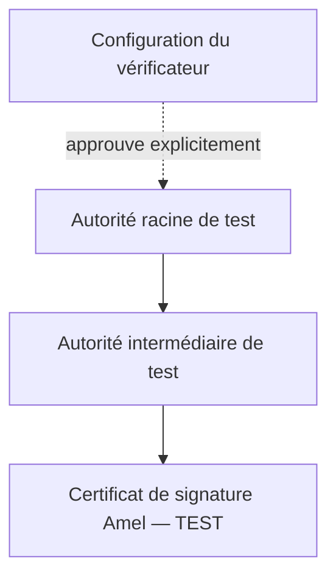

# PKI et certificats X.509 : comprendre la chaîne de confiance

Comment savoir à qui appartient la clé qui a signé un PDF ? Vérifier le calcul cryptographique ne suffit pas à répondre à cette question. Une infrastructure à clés publiques, ou **PKI**, organise le lien entre les clés, les identités et les règles de confiance.

Cette fiche explique la PKI utilisée dans les exemples et dans l’application locale DZ Sign. Les identités décrites sont fictives. Références consultées le **11 novembre 2026** : [registre technique](../../resources/references.md).

## Partir d’un document concret

Imaginons qu’Amel, une identité fictive de démonstration, signe une attestation PDF. Elle dispose d’une paire de clés : la clé privée sert à produire la signature, la clé publique permet de la vérifier. Le certificat accompagne cette clé publique avec des informations sur son titulaire et son émetteur.

Dans DZ Sign, nous voulons pouvoir répondre séparément à ces questions :

1. La signature correspond-elle aux données couvertes du PDF ?
2. Le certificat peut-il être relié à une autorité approuvée dans cet environnement ?
3. Les dates, les usages autorisés et le statut de révocation permettent-ils de l’accepter selon les règles retenues ?

## Lire un certificat X.509

Un certificat contient une clé publique, jamais la clé privée correspondante. Il est signé par son émetteur. Les principaux champs à lire sont les suivants :

| Champ | Question à laquelle il répond |
|---|---|
| Subject | Quel sujet le certificat désigne-t-il ? |
| Issuer | Quel émetteur est indiqué ? |
| Serial number | Quel numéro identifie ce certificat chez cet émetteur ? |
| Validity | Entre quelles dates est-il prévu pour être valide ? |
| Subject public key info | Quelle clé publique et quel algorithme contient-il ? |
| Basic constraints | Peut-il agir comme certificat d’autorité ? |
| Key usage / Extended key usage | Quels usages sont permis ou restreints ? |

Une date correcte ne suffit pas : il faut aussi vérifier les signatures, les contraintes et les usages. Le nom de l’émetteur ne prouve pas à lui seul qu’il a signé le certificat. Une extension critique non comprise impose de rejeter le certificat. Ces éléments et la validation sont décrits dans la [RFC 5280, sections 4 et 6](https://www.rfc-editor.org/rfc/rfc5280).

## Remonter jusqu’à une confiance choisie

Le schéma suivant représente une hiérarchie proposée pour les futurs exemples. Les flèches indiquent qui émet le certificat suivant.

Construire une chaîne consiste à chercher un chemin entre le certificat cible et une ancre de confiance. Valider ce chemin consiste ensuite à vérifier qu’il respecte les règles applicables. Un intermédiaire manquant peut empêcher cette construction. Plusieurs chemins peuvent aussi exister : la chaîne n’est pas toujours une simple liste unique. La [RFC 4158](https://www.rfc-editor.org/rfc/rfc4158) explique cette distinction et les difficultés de construction.

Pour notre exemple, la racine sera approuvée explicitement dans la configuration de test de DZ Sign. L’inclure dans un PDF ne devra jamais suffire à la faire approuver. Un autre lecteur PDF pourra donc afficher une signature non approuvée, même si le document est intact. Ce sera un résultat attendu à expliquer dans le guide.

## Une PKI comprend aussi des responsabilités

Une autorité de certification, ou CA, émet les certificats. Une autorité d’enregistrement, ou RA, peut prendre en charge l’identification et l’examen des demandes. Ces rôles peuvent appartenir à une même organisation.

La politique de certification décrit les règles applicables ; la déclaration des pratiques de certification expose comment elles sont mises en œuvre. La [RFC 3647](https://www.rfc-editor.org/rfc/rfc3647) fournit un cadre pour les documenter, notamment pour l’identification, la délivrance, l’utilisation et la fin de vie des certificats.

Dans notre démonstration, l’identité « Amel — TEST » sera créée pour les essais. Elle ne représentera pas une identité vérifiée auprès d’une institution. Les modalités d’une véritable identification ne sont pas simulées par le simple remplissage du champ Subject.

## Suivre le cycle de vie

Le parcours de démonstration prévu devra rendre visibles les étapes suivantes. Il s’agit de choix pédagogiques du projet, inspirés du cadre de gestion décrit dans la [RFC 3647, section 4](https://www.rfc-editor.org/rfc/rfc3647).

| Étape | Ce que nous voulons montrer |
|---|---|
| Préparation | Définir une identité fictive et les usages du certificat |
| Création des clés | Générer la paire ; conserver la clé privée hors du dépôt |
| Demande et délivrance | Faire émettre le certificat de test et examiner son contenu |
| Utilisation | Signer un PDF puis vérifier la signature et la chaîne |
| Renouvellement | Émettre un nouveau certificat ; distinguer ce cas du changement de clés |
| Incident | Signaler une clé compromise et révoquer le certificat concerné |
| Expiration | Constater la fin de la période de validité sans modifier l’ancien certificat |
| Conservation | Garder les éléments publics utiles à l’analyse des signatures passées |

L’automatisation de ces scénarios viendra avec les exemples pratiques. La première version de l’application n’implémentera pas nécessairement tous les services d’une PKI.

## Comprendre le statut de révocation

Une réponse OCSP fournit un statut pour un certificat : `good`, `revoked` ou `unknown`. `good` ne constitue pas une validation complète du certificat et ne garantit pas, à lui seul, qu’il a été émis. La réponse doit notamment être authentifiée et ses indications temporelles examinées. Un service inaccessible ne permet pas de conclure à un statut favorable. Voir la [RFC 6960, sections 2.2, 3.2 et 4.2.2.1](https://www.rfc-editor.org/rfc/rfc6960).

La fiche [du fichier à la vérification d’une signature](signature-validation.md) complète ces notions avec le hachage, l’horodatage, les CRL et les scénarios de révocation.

## Ce que DZ Sign devra expliquer

Voici des exemples de résultats attendus, et non des essais déjà exécutés :

| Situation de test | Explication à présenter |
|---|---|
| PDF intact, racine de test approuvée | Présenter séparément l’intégrité et le résultat de validation du certificat |
| Même PDF, racine non approuvée | Expliquer que la configuration ne permet pas d’établir la confiance |
| Intermédiaire nécessaire absent | Signaler que le chemin n’a pas pu être construit avec les éléments disponibles |
| Certificat expiré à la date d’évaluation | Afficher la date retenue et le problème de validité temporelle |
| Contrôle de révocation non réalisé | Afficher « non vérifié », avec la raison |

Pour les premières vérifications, le projet retiendra explicitement la date d’évaluation courante. L’étude d’une signature passée demandera de préciser la politique temporelle et les preuves disponibles. Une date simplement déclarée par le signataire ne devra pas être traitée comme un horodatage de confiance.

Cette fiche pose les notions nécessaires au prototype. La gestion concrète des clés, les algorithmes, les durées de validité et les paramètres des certificats seront fixés avant la génération des exemples. Le lien avec le cadre algérien est expliqué dans la [fiche juridique](../algeria/legal-framework.md) ; aucune qualification juridique n’est déduite de la seule présence d’un certificat.
